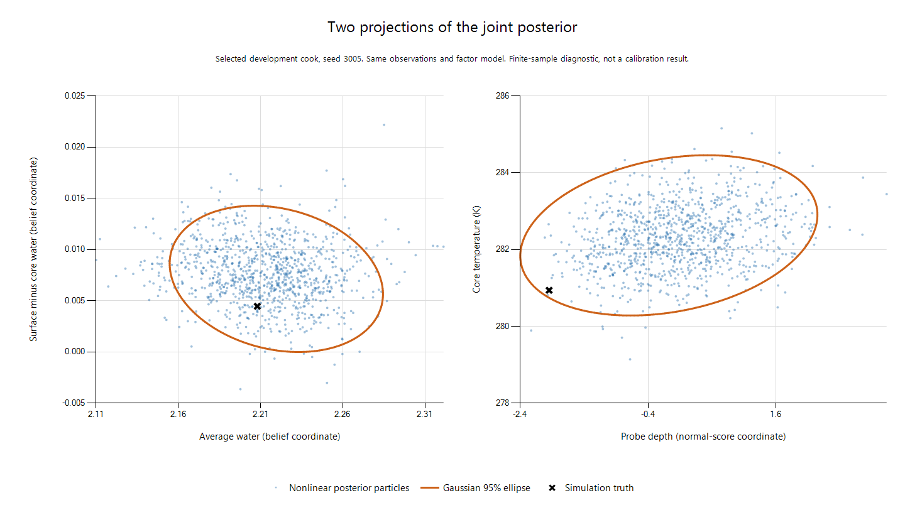

# Factor graph consistency review — 2026-09-27

Reviewed from `ee667fd`. The Gaussian approximation remains overconfident on independent declared-model
controls after the objective/calibration defects are repaired. The working tree now also contains an
incremental nonlinear posterior backend (`sampled_init`), a full-history offline fitter (`sampled_fit`), actual posterior quantiles and
independent calibration controls. It targets the original nonlinear graph distribution rather than a
locally fitted Gaussian. End-to-end statistical consistency and real-time deployment have **not** been
established, and no new noise rates have been fit.

The earlier focused checks totaled **791 passing repository assertions**: factors 248, bench-system 222,
selected online sets 125, consistency/coordinates 90, nonlinear posterior 32, SMC analytic/measurement
oracles 38, sampled transactions 26, and validation bookkeeping 10. The posterior, analytic-kernel,
transaction and bookkeeping checks passed in a fresh process under backend `99b9c943ab89`, together with
two checks that the integrated kernel reproduces the frozen candidate's exact draws and diagnostics
(108 fresh-process assertions; [log](validation/2026-09-27/production_validation.log)). These are
correctness checks, not calibration evidence. The full repository test suite was not run.

The subsequent online/offline implementation, sampled forecast/planning interfaces and their limits are
described in [sampled estimation](sampled-estimation.md). The archived counts and fingerprints below
refer to the earlier versions, not the subsequent implementation.

## Corrections

### A dynamics factor must retain one probability model

`DynamicsFactor` mapped physical process covariance into state coordinates, capped it, and added an integration-error floor. It then recomputed that covariance whenever it refreshed the dynamics Jacobian. Trial points used the previous weights. Consequently, refreshing a Jacobian at an unchanged point could change the objective. The reported score and covariance also omitted derivatives of the changing weights and the Gaussian normalization.

The factor now fixes its coordinate covariance at its initial prediction. Online/offline construction anchors it before fitting observations. The primal dynamics and their Jacobians still change with the estimate. The stored reference coordinate `wy` also supplies the calibration sensitivity, so fitting noise and solving the graph use the same reference. Checkpoint copies and rollback retain it.

The regression reproduced the defect on `ee667fd`: at the same variable values, refreshing the Jacobian changed the dynamics loss from **1106.3772 to 1621.6073**. With the correction, the loss remains unchanged through refresh and explicit cache invalidation, and its directional derivative agrees with a finite difference.

This is a conditional, fixed-noise Gaussian approximation. It is **not** an exact implementation of a physical, state-dependent diffusion. If that is desired, the objective must include both the covariance dependence and its log determinant. Aravkin and Burke derive the corresponding likelihood and generalized Gauss–Newton treatment in [Smoothing Dynamic Systems with State-Dependent Covariance Matrices, equation 7](https://arxiv.org/pdf/1211.4601). The standard inverse-Jacobian-Gram covariance assumes appropriately whitened residuals; see [Ceres covariance estimation](https://ceres-solver.readthedocs.io/latest/nnls_covariance.html).

### Partial sensor arrivals need the full gain

The predictive covariance previously contained only variables touched by uncensored observations at that arrival. This suffices for NIS. It does **not** suffice for ALS: an idle sensor's discrepancy is correlated with the state and is updated by a reporting sensor. Embedding the smaller covariance in a zero matrix erased those gain rows, making the calibration's error recursion disagree with the estimator.

When ALS is attached, predictive covariance now includes the complete newest-node frame, including every existing sensor discrepancy. An independent three-state Kalman oracle checks the correction of a sensor that did not report. This follows the fixed-gain error-dynamics formulation of [Odelson, Rajamani and Rawlings, A new autocovariance least-squares method for estimating noise covariances](https://www.sciencedirect.com/science/article/pii/S0005109805003262).

In the regression, a one-kelvin fast-sensor innovation should correct the idle discrepancy by approximately **−0.45745 K**. The original feed reports **zero** for that correction.

The initial OU discrepancy also has variance `theta_ou`, so its variance derivative is one. It was previously zero. This is distinct from the separate, fixed initial widths of the physical state.

### Differentiate the covariance actually used at events

`_process_cov_sens` omitted event disturbances before applying the nonlinear coordinate cap. Although the disturbances have zero derivative with respect to the fitted rate, they alter the point at which that cap is differentiated. The derivative now includes them inside the map. A finite-difference check exercises a near-empty fuel state across an addition, where the cap makes the distinction substantial.

On that fixture, the original fuel-variance derivative is **336.649**, while the correctly capped derivative is **below 0.0001**. The corrected derivative passes the finite-difference check.

### Calibration bookkeeping

- Censored-only arrivals now advance the transition and process sensitivities with zero scored observation rows; they no longer silently drop an interval.
- ALS explicitly requires one timestamp per batch and strictly increasing arrivals. The smoother still accepts delayed data without ALS. A newest-state recursion cannot silently represent a delayed update or several transitions as one step.
- Belief/covariance extraction finishes before the accumulator is mutated, avoiding statistics for a rolled-back extraction failure.
- Backend fingerprints now include `als.jl` and `bench_fit.jl`; changes to calibration mathematics must invalidate old calibrations too.
- The existing online layout test still demanded that ignition use the frozen filter's `:unit` kind, although the committed implementation already used `:ignited`. It now checks that single documented exception explicitly and requires every other kind to match exactly.

## Why more noise tuning is not yet proof of consistency

These additional issues are present in the reviewed code. They are separate from the corrections above.

1. **The benchmark named `matched` is not a generatively matched test.** `realcook.jl:read_at` generates OU noise without the extra independent white noise used by `coverage_system.jl`'s sensors. Its pit noise also increases after a fuel addition (`pit_add_bump = 2`), whereas the graph uses stationary OU noise. Its clean core probe uses linear interpolation (`clean_at`); `semantic.jl:_slab_temperature_at` uses cubic Hermite interpolation. Neither interpolation is inherently wrong, but they are different observation models. Preserve this real-cook stress test and add a separately labelled, genuinely matched control before attributing its failures to covariance algebra.
2. **The softened boundary encode was not the inverse of decode in its transition band.** For example, a normalized unit fraction of 0.002 mapped to approximately 0.00163212 after encode/decode, even without physical evolution. The continuation replaces it with the exact inverse in the physical interior and a numerical clipping layer of approximately 2e-8 at the boundaries. Repeated handoffs and derivatives now preserve interior values. This removes deterministic coordinate drift; it does not by itself fix posterior coverage.
3. **Fixed-lag marginalization freezes old nonlinear information.** The QR elimination passes linear Kalman/RTS parity, but that does not imply nonlinear consistency on the depth/temperature or ignition/fuel ridges. Literature demonstrates artificial information from incompatible linearization points in fixed-lag estimation: [Dong-Si and Mourikis, Motion Tracking with Fixed-lag Smoothing, section III](https://tdongsi.github.io/download/pubs/DongSi2011ICRA.pdf). Applying that result to these cooking-model ridges is a hypothesis to test, not an established diagnosis. Compare against a short full-history solve before designing a first-estimate/observability-preserving Jacobian policy.
4. **ALS remains an approximation for iterated and censored updates.** The feed uses the first linearization's Gaussian gain. It does not model the final nonlinear update's effective gain or the survival-likelihood update of a censored sensor. Keeping only uncensored readings is also selection on the observation, so those innovations are not generally untruncated zero-mean Gaussian samples. Advancing the missing transitions fixes bookkeeping; it does not make censored ALS exact.
5. **Gauss–Newton covariance is a local approximation.** On nonlinear ridges, small gradients and positive definite covariance do not establish correct coverage. NIS alone also does not establish correct state/parameter uncertainty.

## Validation

`estimator/test/test_consistency.jl` passed **19/19** focused regressions for the idle-discrepancy Kalman correction, initial OU variance, arrival-order validation, empty observation blocks, an unchanged objective across relinearization, its directional derivative, and event covariance sensitivities.

The existing factor suite covers linear Kalman/RTS parity, fixed-lag elimination, delayed insertion, dropout, hierarchy, censoring, and numerical solver safeguards. It passed **248/248** checks. The existing `test_bench_system.jl` passed **222/222** checks, including synthetic variance recovery, calibration serialization/fingerprints, nonlinear arrivals, latent drift, and field covariance structure.

The selected online sets (`layout,observables,transactions,arrivals,subsets`) passed **125/125** checks, including rollback/checkpoint behavior, eight streaming arrivals, sensor subsets, dropouts, and censoring. Together these runs passed **614/614** assertions.

Tests used Julia 1.11.9 with one OpenBLAS thread; the nonlinear suites used four Julia threads. The new regressions were also run against saved `ee667fd` sources to reproduce the objective change, missing discrepancy gain/initial variance, dropped empty rows, and incorrect event derivative.

A seed-1, 30-minute cooking smoke at lag zero was run both with saved `ee667fd` sources and with the correction (backend `01a4960c4f97`). Both committed **16/16** arrivals with no skipped cooks:

| Metric, mean over arrivals | Original | Corrected |
| --- | ---: | ---: |
| NIS/dof | 0.9099 | 0.9096 |
| Latent NEES/16 | 1.8627 | 1.8631 |
| Temperature NEES/3 | 0.7294 | 0.7296 |

These descriptive numbers are essentially unchanged; this smoke does **not** demonstrate improved coverage. It uses the unchanged real-cook stress-test generator and default noise rates, without fitting new rates or enabling ALS. The direct regressions establish the repaired contracts; broader statistical validation remains necessary.

Reproduce the focused checks from the repository root:

```powershell
$env:OPENBLAS_NUM_THREADS = '1'
julia --threads=4 --project=estimator estimator/test/test_consistency.jl
julia --threads=4 --project=estimator estimator/test/test_factors.jl
julia --threads=4 --project=estimator estimator/test/test_bench_system.jl
$env:TEST_ONLINE_ONLY = 'layout,observables,transactions,arrivals,subsets'
julia --threads=4 --project=estimator estimator/test/test_online.jl
Remove-Item Env:TEST_ONLINE_ONLY
$smoke = Join-Path (Get-Location) 'scratchpad/consistency_smoke.json'
julia --threads=4 --project=estimator estimator/scripts/coverage_system.jl prior_next_cook.json 1 1 $smoke 0.5 0 default 0 0 0 matched
```

The full estimator suite, long nonlinear lag/parity tests, multi-piece/offline/ROM/planner suites, and full-duration multi-cook coverage were not run in this review. No calibration file or archived benchmark result has been overwritten. Existing calibration/checkpoint fingerprints change as intended. Fresh multi-cook coverage is required before claiming that the resulting estimator is statistically consistent.

## Continuation: posterior approximation and generalization

The requested outcome is statistical consistency, not just the contract repairs above. The new
`estimator/scripts/consistency_control.jl` generates independent cooks from the declared conditional
graph model, including initial state, latent priors, dynamics disturbances, stationary OU sensor noise
and independent instrument noise. Score-coordinate priors are drawn directly as standard normals.
It records failed cooks and reports statistics at fixed times across independent cooks rather than
counting temporally correlated arrivals as independent replicates.

The process covariance is the factor's fixed covariance predicted from past data. This is a legitimate
conditional model but remains distinct from a continuous physical diffusion. Different algorithms can
anchor different process covariances, so equal random seeds alone do not imply identical generated plants.
Comparisons of posterior representations on an already constructed graph do use the same data and model.

Development experiments tried prior and posterior statistical linear regression, joint state/latent
quadrature, increased quadrature resolution, repeated smoothing, damping and retained full history.
None has established consistency. In particular, increasing quadrature from 256 to 1,024 points did not
remove the state overconfidence. Some iterated variants did not converge. Early eight-cook improvements
did not survive larger development runs. The earlier development harness used the legacy approximate
Beta inverse-CDF truth sampler; those runs are diagnostic, not exact simulation-based calibration.

The coordinate regressions now contain 90 assertions, including 71 new boundary/interior checks.
A representative continuous-trajectory check reduced the maximum encoder/decoder drift from approximately
0.001 to 2e-8. The coordinate fix alone did not calibrate the Gaussian estimator.

A nonlinear posterior backend now works in independent latent/initial-state/process-noise
coordinates. Every sampled trajectory goes through the same nonlinear dynamics. For uncensored readings,
the Gaussian OU sensor discrepancies can be integrated out analytically using each sensor's declared
covariance and timestamps. This preserves nonlinear parameter/state relationships without fitting an
empirical correction to a failing seed. `sample_posterior` provides a defensive importance reference;
`sample_posterior_smc` bridges a local-Gaussian/prior mixture to the nonlinear posterior with resampling
and invariant elliptical-slice moves. Independent particle systems estimate Monte Carlo error, including
small joint state-profile contrasts. A final array of uniform particle weights is not counted as independent
effective samples. The proposal changes computation, not the target distribution or sensor noise.

`sampled_init` provides an explicit online API for the sampled backend. It retains full history, increases
the particle count when precision is inadequate, and rolls back an update that reaches the work limit
without passing. It does not substitute an inaccurate Gaussian belief after a sampling failure.

```julia
using Random
sm = sampled_init(model; particles=512, max_particles=4096,
                  replicates=8, rng=MersenneTwister(42))
result = assimilate!(sm, batch) # ordinary MeasurementRecord vector
if result.committed
    posterior = result.posterior
    physical_intervals = posterior_quantile(posterior; physical=true)
    joint_draws = posterior.draws # rows [latent coordinates; latest belief coordinates]
end
```

On failure, `result.committed` is false and `result.belief` is the previous accepted belief, with its
original timestamp. The caller must retain/retry the readings or explicitly record a gap. Precision
checks are estimates and cannot guarantee discovery of an unseen mode. Increasing particles and
independent calibration checks remain necessary.

The implementation currently requires static latents, full history and uncensored readings. It supports
sensor composition through ordinary factor declarations, including separate uncertain probe depths.
It does not support Gaussian fixed-lag marginal priors, drift/hierarchy factors, or the Gaussian ALS
recursion. Runtime grows with retained history. The existing `online_init` default remains Gaussian.
The sampled backend is experimental, not yet a validated real-time deployment replacement.

Planning also needs further integration: joint samples must survive prediction/control, and uncertain
path-dependent quality integrals and future disturbances must be propagated. Converting the sampled
posterior to the existing Gaussian `BeliefSnapshot` would discard the distribution this change preserves.
The new backend does not silently make that conversion.

In a selected development case with the same observations and factor model, Gaussian normalized state
NEES was 75.5. Nonlinear posterior calculations gave approximately 1.5–2.4, depending on sampler and finite
sampling error. This is evidence against the local covariance approximation, not a calibration pass:
several importance and small-particle SMC runs failed their precision checks. Higher marginal moments
alone do not capture nonlinear joint state/parameter relationships. The comparison points to the joint
posterior approximation as a source of error; it does not identify every cause of inconsistency.
No noise rates or covariance multipliers were fit to that case.



These are 1,024 exploratory SMC draws from the selected development case. These two-dimensional
projections do not by themselves explain the large joint state error: the water contrast has nonzero
Gaussian conditional variance (8.15e-6). An earlier rendering incorrectly rounded that variance to
zero; the figure is corrected. The scatter is a geometry diagnostic, not a calibrated confidence
region or a held-out result. The joint numerical comparison above uses the full state covariance.
Its Gaussian score was also checked with diagonal scaling and 256-bit arithmetic: all three calculations
agree within 1e-9 at a score of 75.51491. That numerical result is not an artifact of the corrected plot
or of an unstable double-precision covariance solve.

This comparison concerns MAP plus first-order covariance, not every possible Gaussian approximation.
A Gaussian matched to the true posterior mean and covariance would reproduce mean-squared uncertainty,
although its quantiles and subsequent nonlinear predictions could still be wrong. Marginal skewness or
kurtosis alone cannot recover missing joint relationships. The sampled reference retains those relationships
and gives a target against which faster moment-based approximations can be assessed.

Relevant methods are [iterated posterior linearization](https://research.chalmers.se/publication/249335/file/249335_Fulltext.pdf),
[elliptical slice sampling](https://proceedings.mlr.press/v9/murray10a.html), and
[rank-normalized convergence diagnostics](https://arxiv.org/abs/1903.08008).
The particle bridge follows [sequential Monte Carlo samplers](https://www.stats.ox.ac.uk/~doucet/delmoral_doucet_jasra_sequentialmontecarlosamplersJRSSB.pdf).

The target can be checked directly. Let `u` collect independent standard-normal prior coordinates for
the static latents, initial state and process disturbances. The nonlinear trajectory map `T(u)` uses the
graph's fixed process roots. After integrating out the linear Gaussian sensor discrepancies, the
conditional target is proportional to

```text
exp(-0.5 * u'u - 0.5 * ||L^-1 (h(T(u)) + discrepancy_mean - readings)||^2)
```

Here `L*L'` is the discrepancy covariance at the observed timestamps plus independent measurement
variance, derived from the actual graph factors. Its determinant is constant in `u`. The prior/trajectory
change of variables has constant determinant because process roots are anchored. Thus this is the
original graph posterior in different coordinates, not a moment-fitted surrogate.

For a defensive Gaussian-mixture proposal `q`, the SMC targets are `q^(1-beta) * p^beta`, ending at `p`.
Conditioning on a mixture label with probability proportional to its component density gives a Gaussian
reference for an elliptical-slice move with log residual `beta * log(p/q)`. This preserves the bridge
target. Finite particle systems still have Monte Carlo error, resampling dependence and possible missed
modes; the mathematical target identity does not establish finite-computation calibration.
For calibration, [simulation-based calibration](https://arxiv.org/abs/1804.06788) motivates independent
prior/data draws and posterior rank checks. Non-Gaussian posterior validation must use actual quantiles/ranks;
Gaussian chi-square bands and mean ± 1.96 SD intervals are not generally valid for an expressive posterior.

The deployment and held-out validation requirements are specified in
[estimator-generalization-validation.md](estimator-generalization-validation.md). They explicitly include
one probe, two probes, uncertain placement and model mismatch. Selected development examples are not a
substitute for those tests or for held-out real cooks.

## First frozen independent smoke

Backend `d13260bf551f`, validation/prior fingerprint `a72461cf51eb`: two untouched seeds (20001, 20002)
per suite, four spatial nodes, observations at 0, 300 and 900 seconds. All suites used 1,024 particles per
system initially, up to 4,096, eight independent systems and four rejuvenation moves. One mixed-suite
case automatically increased to 2,048 particles; the other nine used 1,024. All ten combinations completed
and met the numerical precision checks. These are two independent cooks within each suite; the reused
seeds across suites are not ten independent replicates for a pooled statistic.

| Sensor suite | Numerically qualified / attempted | Gaussian state score | Sampled state score |
| --- | ---: | ---: | ---: |
| One meat probe | 2 / 2 | 3.818 | 1.269 |
| Two meat probes, separate uncertain depths | 2 / 2 | 1.232 | 0.844 |
| One pit probe | 2 / 2 | 4.533 | 1.297 |
| Pit plus meat | 2 / 2 | 6.326 | 1.407 |
| Pit, meat, humidity and mass | 2 / 2 | 10.686 | 1.241 |

Scores are mean normalized state Mahalanobis errors for the two cooks, comparing posterior representations
on the same graph and observations within each case. They are descriptive, not Gaussian chi-square tests
of a non-Gaussian posterior. The predeclared calibration gate remains **not passed** because two cooks per
suite are insufficient. Runtime and all per-cook diagnostics/ranks are preserved in the
[frozen smoke record](validation/2026-09-27/original_smoke_summary.json) and its per-suite JSON files.

An earlier attempt failed for all ten cases because the test control grid stopped at 840 seconds, before
the 900-second observation. The grid-coverage bug was repaired without changing inference or precision
thresholds; the invalid attempt is recorded in the manifest and `setup_failure.log` alongside the rerun.

The harder 30-minute development case 3011 still failed numerical precision with the original kernel at
2,048 particles per system and eight systems (mean ESS 443, minimum tail ESS 186). Its state score was
approximately 1.07, but that plausible score does not override the failed precision diagnostics.

## Weak-direction refresh and second frozen smoke

The integrated sampler retains full-space elliptical moves and adds a separate refresh of the weakly
informed reference directions. The subspace is computed from the proposal's latent directions and
likelihood Jacobian, without simulation truth or a sensor-suite label. Conditional on the complementary
coordinates and mixture component, the reference distribution is still Gaussian; the elliptical move
uses the complete nonlinear `beta * log(p/q)` slice test. Thus this changes exploration, not the
probability model. A rotated correlated-Gaussian oracle and a curved distribution with known mixed
moments check that the extra move preserves joint dependence.

Development runs with 512 particles per system still failed precision on full-suite seeds 3011 and
3012; they are preserved in the validation archive. At 1,024 particles and eight systems, seeds 3011
and 3013 passed with minimum mean ESS 1,997 and 1,850 and minimum tail ESS 1,099 and 532 respectively.
Seed 3013's descriptive state score changed from 358.4 under the Gaussian approximation to 1.319 under
sampling. These selected development results are not evidence of generalization.

The refresh kernel was then frozen (`3be77d24382a`) against target backend `d13260bf551f` and validation
fingerprint `a72461cf51eb`. All six newly evaluated cases completed and met numerical precision at the
same 1,024 particles per system, eight systems and four full-space moves. No retry at a larger particle
count was needed. The first five use seed 20003 and times 0, 300, 900 seconds; the last uses seed 20004
and times 0, 240, 840, 1800 seconds.

| Sensor suite / endpoint | Gaussian state score | Sampled state score |
| --- | ---: | ---: |
| One meat probe / 15 min | 18.000 | 1.114 |
| Two meat probes / 15 min | 8.383 | 0.889 |
| One pit probe / 15 min | 8.348 | 1.189 |
| Pit plus meat / 15 min | 41.387 | 1.111 |
| Full suite / 15 min | 0.988 | 1.010 |
| Full suite / 30 min | 10.493 | 2.302 |

These remain descriptive scores and **not a statistical calibration pass**. In particular, the final
sampled score is 2.302, not approximately one. Actual posterior ranks and quantile coverage, failures,
runtime and fingerprints are in the [second frozen smoke record](validation/2026-09-27/blocked_smoke_summary.json)
and its per-case files. Cooks take roughly 2.5–14 minutes here, depending on trajectory and configuration;
these short simulations do not establish practical cost or calibration for a full real cook.

The sampled public API now defaults to 1,024 particles per system and eight independent systems. These
are numerical work settings shared by all sensor suites; model/noise parameters and precision thresholds
were not fitted to the evaluation truths. The default `online_init` API is still the Gaussian backend.
