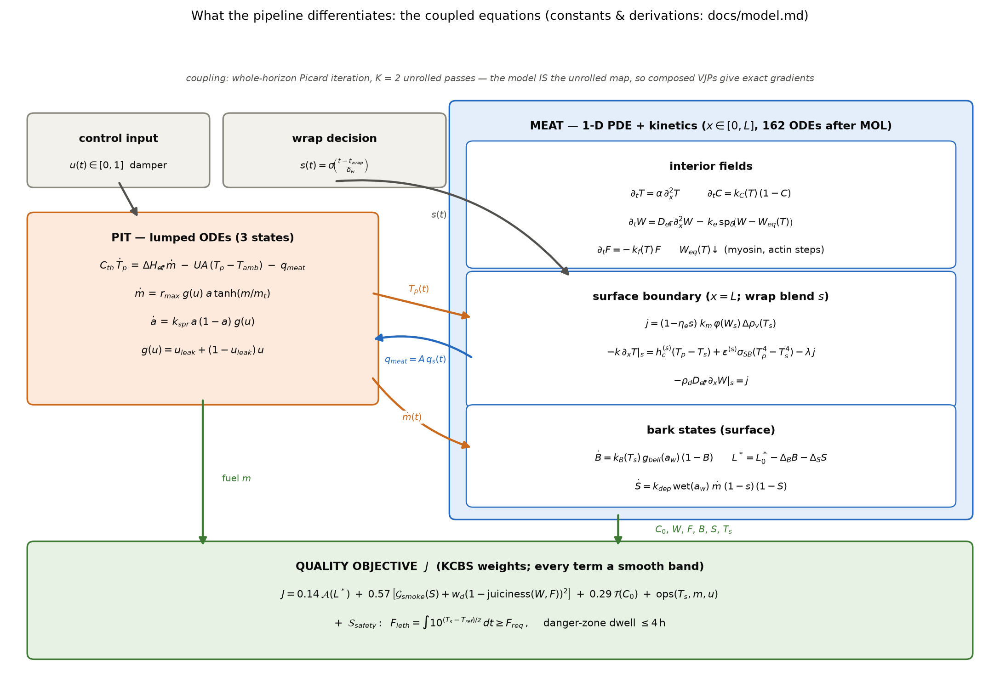

# The model, mathematically

Every equation the code integrates, in one place. Notation follows the
source (`src/meat.jl`, `src/pit.jl`, `app/src/brisket_app/control.py`);
calibrated latents are marked **θ** (meat) or **φ** (pit); everything else
is a fixed constant from `MeatConfig`/`PitConfig` with its provenance
commented in the source. All switches are smooth (logistic
$\sigma(x) = \tfrac12(1+\tanh(x/2))$, softplus
$\mathrm{sp}_\delta(x) = \delta\log(1+e^{x/\delta})$) — no branch ever
enters the adjoint.

## 1. Meat: 1-D heat–moisture–kinetics PDE (162 ODEs after MOL)

Half-slab $x \in [0, L]$, symmetry at the center $x=0$ (probe location),
convective/radiative/evaporative boundary at the surface $x=L$. States:
temperature $T(x,t)$ [K], dry-basis moisture $W(x,t)$ [kg water / kg dry],
collagen conversion $C(x,t) \in [0,1]$, un-rendered fat $F(x,t)$ [kg fat /
kg dry], plus two surface bark states $B, S$. Method of lines on
$n_x = 40$ uniform nodes → $4n_x + 2 = 162$ stiff ODEs (FBDF).

**Interior transport** (θ: $D_{\mathrm{eff}}$, $k_{\mathrm{mult}}$; with
$\alpha = k_{\mathrm{mult}} K_{\mathrm{meat}} / (\rho c_p)$):

$$
\frac{\partial T}{\partial t} = \alpha\,\frac{\partial^2 T}{\partial x^2},
\qquad
\frac{\partial W}{\partial t} = D_{\mathrm{eff}}\,\frac{\partial^2 W}{\partial x^2}
\;-\; k_e\,\mathrm{sp}_{\delta_e}\!\big(W - W_{\mathrm{eq}}(T)\big),
$$

with symmetry ($\partial_x T = \partial_x W = 0$) at $x = 0$.

**Denaturation-driven expulsion** (the purge; θ: $k_e$, $a_{\mathrm{myo}}$)
relaxes $W$ one-sidedly toward a temperature-dependent water-holding
equilibrium with two smooth denaturation steps (myosin ~58 °C, actin
~72 °C):

$$
W_{\mathrm{eq}}(T) = W_0\Big(1
- a_{\mathrm{myo}}\,\sigma\!\big(\tfrac{T - T_{\mathrm{myo}}}{\delta_{\mathrm{myo}}}\big)
- a_{\mathrm{act}}\,\sigma\!\big(\tfrac{T - T_{\mathrm{act}}}{\delta_{\mathrm{act}}}\big)\Big).
$$

**Fat rendering** (pure sink; render switch ~55 °C):

$$
\frac{\partial F}{\partial t}
= -\,k_{f0}\;\sigma\!\Big(\frac{T - T_{\mathrm{render}}}{\delta_{\mathrm{render}}}\Big)\,F .
$$

**Collagen (doneness) kinetics**, Arrhenius referenced to $T_{\mathrm{ref}}$:

$$
\frac{\partial C}{\partial t}
= k_{\mathrm{ref}}\,
\exp\!\Big[-\frac{E_a}{R}\Big(\frac{1}{T} - \frac{1}{T_{\mathrm{ref}}}\Big)\Big]\,(1 - C).
$$

**Surface boundary condition** — the stall mechanism. Evaporative flux is
mass-transfer-limited with a smooth moisture-availability switch and a
smoothly clamped vapor-density deficit (θ: $k_m$, $h_c$):

$$
j_{\mathrm{evap}}
= k_m\,
\underbrace{\sigma\!\Big(\frac{W_s - W_{\mathrm{crit}}}{\delta_W}\Big)}_{\text{availability}}
\;\frac{\mathrm{sp}_{\delta_p}\!\big(p_{\mathrm{sat}}(T_s) - p_{v,\mathrm{pit}}\big)}{R_v\,T_s},
$$

$$
-k\,\frac{\partial T}{\partial x}\Big|_{s}
= h_c\,(T_{\mathrm{pit}} - T_s)
+ \varepsilon\,\sigma_{SB}\,(T_{\mathrm{pit}}^4 - T_s^4)
- \lambda_{\mathrm{vap}}\, j_{\mathrm{evap}},
\qquad
-\rho_d D_{\mathrm{eff}}\,\frac{\partial W}{\partial x}\Big|_{s} = j_{\mathrm{evap}} .
$$

**Texas crutch (wrap)** — a smooth blend
$s(t) = \sigma\big((t - t_{\mathrm{wrap}})/\delta_{\mathrm{wrap}}\big)$
modifies the surface exchange (foil defaults; $t_{\mathrm{wrap}}$ is a
differentiable decision variable):

$$
j \to (1 - \eta_{\mathrm{evap}}\, s)\, j,\qquad
h_c \to h_c\,(1 - \eta_h\, s),\qquad
\varepsilon \to \varepsilon\,(1-s) + \varepsilon_{\mathrm{wrap}}\, s,
$$

and smoke contact is blocked by $(1-s)$ in the deposition state below.
$t_{\mathrm{wrap}} = 10^9$ makes $s \equiv 0$ bitwise (unwrapped model
recovered exactly).

**Bark states** (surface only). Maillard browning $B$ with an Arrhenius
rate modulated by a water-activity bell over the Oswin isotherm
$a_w(W_s) = \big(1 + (k_{ox}/W_s)^{n_{ox}}\big)^{-1}$, and smoke-phenolic
deposition $S$ gated by a *wet* (tacky) surface and driven by the pit's
burn rate $\dot m$ (the smoke-flux forcing):

$$
\dot B = k_{0,\mathrm{bark}}\, e^{-E_{a,\mathrm{bark}}/(R T_s)}\;
\exp\!\Big[-\frac{(a_w - a_{pk})^2}{2\sigma_{aw}^2}\Big]\,(1 - B),
$$

$$
\dot S = k_{\mathrm{dep}}\;
\sigma\!\Big(\frac{a_w - a_{\mathrm{dry}}}{\delta_{\mathrm{dry}}}\Big)\;
\max(\dot m, 0)\;(1 - s)\;(1 - S),
\qquad
L^* = L^*_0 - \Delta L_B\, B - \Delta L_S\, S .
$$

The split-cook continuity experiment separates their time-weighting
empirically: $S$ is early-weighted (needs the wet surface), $B$ is
late-weighted (hot dry surface).

**Quality summaries** (dry-basis means; $\eta_{\mathrm{drain}}$ = rendered
fat fraction that drips):

$$
w_{\mathrm{ret}} = \frac{\overline W(t_f)}{W_0},\qquad
f_{\mathrm{rend}} = 1 - \frac{\overline F(t_f)}{F_0},\qquad
\mathrm{juiciness} = w_{\mathrm{ret}}
+ \beta_{\mathrm{fat}}\,\frac{(1-\eta_{\mathrm{drain}})\,F_0\, f_{\mathrm{rend}}}{W_0},
$$

with the algebraically closed cook-loss budget (tested to $10^{-8}$):
water lost $= \int j\,dt/(\rho_d L)$ (evaporated) $+$ drip (purge), fat
lost $= \eta_{\mathrm{drain}} F_0 f_{\mathrm{rend}}$ (tallow catch).

## 2. Pit: lumped 3-state ODE

States: gas temperature $T_p$, fuel mass $m$, ignited bed fraction
$a \in (0,1]$ (Minion-method spread). φ = $[C_{th}, UA, r_{\max},
\Delta H_{\mathrm{eff}}, u_{\mathrm{leak}}, k_{\mathrm{spread}}, a_0]$.
With damper $u(t) \in [0,1]$ and airflow
$g(u) = u_{\mathrm{leak}} + (1 - u_{\mathrm{leak}})\,u$:

$$
\dot m = -\,\dot m_{\mathrm{burn}},\qquad
\dot m_{\mathrm{burn}} = r_{\max}\, g(u)\, a\,
\tanh\!\Big(\frac{\max(m,0)}{m_{\mathrm{taper}}}\Big),
$$

$$
C_{th}\,\dot T_p = \Delta H_{\mathrm{eff}}\,\dot m_{\mathrm{burn}}
- UA\,(T_p - T_{\mathrm{amb}}) - q_{\mathrm{meat}},
\qquad
\dot a = k_{\mathrm{spread}}\, a\,(1-a)\, g(u),\quad a(0) = a_0 .
$$

At $a_0 = 1$ the spread term vanishes and the two-state model is recovered
exactly. $\dot m_{\mathrm{burn}}$ is exported (exact algebraic recompute at
save times) as the smoke-flux forcing to the bark model.

## 3. Coupling: unrolled Picard iteration

The components exchange whole trajectories on a shared knot grid, $K = 2$
fixed passes:

$$
\big(T_{\mathrm{pit}}^{(k)},\, \dot m^{(k)}\big)
= P_\varphi\big(u,\, q^{(k-1)}\big),
\qquad
\big(T_{\mathrm{core}},\, j_{\mathrm{evap}},\, q^{(k)}\big)
= M_\theta\big(T_{\mathrm{pit}}^{(k)},\, \dot m^{(k)}\big),
\qquad k = 1 \ldots K,
$$

with $q = A_{\mathrm{meat}} \cdot q_{\mathrm{surface}}$ the meat heat load.
The model is *defined* as the $k = K$ output of this unrolled map, so
reverse-mode AD through the composed Tesseract VJPs (continuous adjoint on
the meat side, transposed ForwardDiff Jacobian on the pit side) is the
exact gradient of the simulated system — no implicit-function
approximation.

## 4. The quality objective (KCBS-weighted; every term overridable)

Decision variables: damper knots $z \mapsto u = \sigma(z)$ and wrap
$z_w \mapsto t_{\mathrm{wrap}} = t_f\,\sigma(z_w)$. With
$\mathrm{sp}(x) = \log(1+e^x)$ and the category weights
$(w_{\mathrm{app}}, w_{\mathrm{taste}}, w_{\mathrm{tend}}) =
(0.14,\, 0.57,\, 0.29)$ (the normalized multipliers KCBS judging carries):

**Tenderness** — two-sided collagen band at the center node,
each side normalized to its band width (under: $c^\star = 0.90$, width
0.05; over: $c_{od} = 0.95$, discounted by $\rho_{ov} = 0.5$ since early
finishes rest):

$$
\mathcal T =
\Big[\tfrac{\mathrm{sp}(20(c^\star - C_0))/20}{0.05}\Big]^2
+ \rho_{ov}\Big[\tfrac{\mathrm{sp}(k_{ov}(C_0 - c_{od}))/k_{ov}}{1 - c_{od}}\Big]^2,
\qquad k_{ov} = \tfrac{4}{1 - c_{od}} .
$$

**Appearance** — two-sided mahogany band on final $L^*$
($[L^*_{lo}, L^*_{hi}] = [28, 34]$, softness $\delta_L = 2$):

$$
\mathcal A =
\mathrm{sp}\Big(\tfrac{L^* - L^*_{hi}}{\delta_L}\Big)^2
+ \mathrm{sp}\Big(\tfrac{L^*_{lo} - L^*}{\delta_L}\Big)^2 .
$$

**Taste** — smoke-deposition band $[S_{lo}, S_{hi}] = [0.55, 0.90]$
(depth without acrid over-deposition) plus dryness on mechanistic
juiciness:

$$
\mathcal G =
\mathrm{sp}\Big(\tfrac{S_{lo} - S_f}{\delta_S}\Big)^2
+ \mathrm{sp}\Big(\tfrac{S_f - S_{hi}}{\delta_S}\Big)^2
+ w_{\mathrm{dry}}\,(1 - \mathrm{juiciness})^2 .
$$

**Food safety, curve-faithful and unconditional.** Surface lethality via
the z-value equivalence (FSIS ~7-log at 60 °C reference, $z = 6$ K,
requirement $F_{\mathrm{req}} = 720$ equivalent seconds), penalized on the
log shortfall, plus a danger-zone dwell cap (growth phase, 4.4–60 °C,
cap 4 h):

$$
F = \int_0^{t_f} 10^{(T_s - T_{\mathrm{ref}})/z}\, dt,
\qquad
\mathcal S = w_F\,\mathrm{sp}\Big(\tfrac{\log_{10} F_{\mathrm{req}} - \log_{10} F}{0.2}\Big)^2
+ w_D\,\mathrm{sp}\Big(\tfrac{h_{\mathrm{zone}} - 4\,\mathrm{h}}{0.5}\Big)^2 .
$$

**Total** (plus operational terms — bark-burn surface cap, fuel fraction,
schedule smoothness):

$$
J = w_{\mathrm{app}}\mathcal A + w_{\mathrm{taste}}\mathcal G
+ w_{\mathrm{tend}}\mathcal T
+ w_s\,\overline{\mathrm{sp}\big(\tfrac{T_s - T_s^{\max}}{\delta_T}\big)^2}
+ w_f\,\Delta m_{\mathrm{fuel}}
+ w_u \textstyle\sum_i (\Delta u_i)^2
+ \mathcal S .
$$

## 5. Calibration likelihood

Masked Gaussian on both probes with the digitization noise floor
$\sigma_0 = 1.2$ K (real-cook model):

$$
y^{\mathrm{pit}}_i \sim \mathcal N\big(T_{\mathrm{pit}}(t_i;\theta,\varphi),\,
(\sigma_0 + \sigma_{\mathrm{pit}})^2\big),
\qquad
y^{\mathrm{core}}_i \sim \mathcal N\big(T_{\mathrm{core}}(t_i;\theta,\varphi),\,
(\sigma_0 + \sigma_{\mathrm{core}})^2\big),
$$

over non-lid-event observations; LogNormal priors centered on the model
defaults (Beta for the (0,1)-bounded $u_{\mathrm{leak}}, a_0$). MAP by
SVI/AutoDelta; posterior by NUTS, every leapfrog step pulling the composed
VJPs across the Julia↔JAX boundary.
