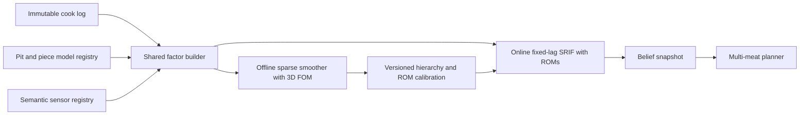

# Unified Multi-Meat Inference Architecture

Build one semantic model and factor infrastructure for heterogeneous meats, arbitrary sensor suites, and multiple cooks. Use a reduced-order square-root fixed-lag backend online and a sparse full-history 3D/hierarchical backend offline, sharing factor definitions but not numerical state representations.

## Architectural decision

- Replace the current single dense star graph with a backend-neutral temporal factor representation. The current RxInfer path may remain as a compatibility oracle, but not the universal engine.
- Share IDs, schemas, immutable cook logs, events, observables, likelihoods, priors, factor objectives/Jacobians, diagnostics, and fingerprints between online and offline estimation.
- Keep numerical implementations distinct:
  - Online: reduced-order meat models, true square-root information filtering/fixed-lag smoothing, bounded memory.
  - Offline: full-history sparse smoothing, full-order 3D transitions, multi-cook hierarchy, selected/low-rank uncertainty.

## Domain and physics layer

- Introduce `CookSystem` with one shared pit and explicit heterogeneous `PieceModel` instances; replace `MeatConfig.n_meat` as the representation of multiple meats while preserving it as a compatibility check.
- Give every piece its own state, parameters, geometry, events, quality targets, and exchange port. Sum heat loads and solve one shared chamber-humidity closure across all pieces.
- Replace positional assumptions in [`src/monolith.jl`](../src/monolith.jl), [`estimator/src/sequential.jl`](../estimator/src/sequential.jl), and [`estimator/src/BrisketEstimator.jl`](../estimator/src/BrisketEstimator.jl) with generated named state/parameter layouts.
- Formalize model-owned initialization, restart, propagation, event application, observables, exchange fluxes, and JVP/VJP operations. Reuse constitutive kernels in [`src/meats/common.jl`](../src/meats/common.jl) and evolve the handoff seam in [`estimator/src/segments.jl`](../estimator/src/segments.jl).

## Sensor-suite agnosticism

- Split the current channel concept into sensor specification, immutable measurement record, semantic observable request, and noise/discrepancy model.
- Address observations by entity and meaning—such as `TemperatureAt(piece, location)`, chamber humidity, or aggregate scale mass—rather than fixed slots in `OutputLayout`.
- Retain the useful censoring/noise likelihoods from [`estimator/src/channels.jl`](../estimator/src/channels.jl), but compile only the requested observables and fail explicitly when a model cannot supply one.
- Represent AR/OU discrepancy states at actual sensor timestamps so irregular sampling, dropouts, sensor replacement, and arbitrary suites require no common mask or time grid.

## Shared factor infrastructure

- Define factors for priors/hierarchies, dynamics, events, observations, sensor discrepancy, parameter drift, ROM error, and online boundary priors.
- Each factor exposes touched variable keys, exact loss, local residual/score, local quadratic approximation, sparse Jacobian blocks or JVP/VJP, and provenance.
- First reproduce the current 1D model through adapters and fix the moving pseudo-observation defect before using it as a migration oracle.

## Online and offline backends

- Implement the online backend first against the existing 1D physics: a square-root information fixed-lag smoother that inserts delayed measurements within the window and marginalizes old local states.
- Implement the offline backend on the same factors: sparse multiple-shooting over the complete history, selected marginals, and hierarchical variables shared across cooks, cookers, cuts, meat instances, and sensor instances.
- Online inference conditions on a frozen versioned hyperposterior; only offline inference updates population/cooker/sensor hierarchy levels.

## 3D and reduced-order models

- Adapt the existing axisymmetric solver in [`src/meats/slab2d.jl`](../src/meats/slab2d.jl) to the model interface before adding full 3D finite-volume physics.
- Treat full 3D as the offline oracle and ROM trainer. Package each ROM with its full-order fingerprint, geometry/archetype, projection/reconstruction operators, validation envelope, and reduction-error model.
- Use the same semantic observables and pit-exchange ports for FOM and ROM. Recalibrate process discrepancy for each ROM rather than carrying over the current 1D state-noise rates.

## Planning and verification

- Generalize [`estimator/src/horizon.jl`](../estimator/src/horizon.jl) to consume model-independent `BeliefSnapshot`s, shared pit controls, per-piece actions/pull times, and per-family quality/safety goals.
- Gate migration with: exact linear Kalman/smoother oracles; one-piece parity; identical-piece parity with current `n_meat`; heterogeneous-piece permutation and conservation tests; arbitrary sensor-subset/dropout tests; fixed-lag/full-history agreement; 3D manufactured solutions and 1D/2D limits; held-out ROM sensor/flux/quality errors; and planted hierarchical recovery.
- Explicitly report unobservable quality states. Multiple cooks improve pooling, but cannot identify collagen, bark, smoke ring, or piece-specific properties without measurements or validated priors.

## Implementation TODOs

- [ ] **Freeze the oracles:** Fix the moving-observation update defect and establish exact linear, censored, restart, and planning reference tests.
- [ ] **Build the semantic core:** Introduce entity IDs, named layouts, immutable cook logs, `CookSystem`/`PieceModel`, events, and exchange-port interfaces with current 1D adapters.
- [ ] **Define sensor and factor infrastructure:** Refactor semantic observations and sensor models, then implement the backend-neutral factor interface and graph builder.
- [ ] **Implement the online backend:** Implement and validate the ROM-capable square-root fixed-lag online backend on current 1D physics.
- [ ] **Generalize to multiple meats:** Replace the identical-copy multiplier with explicit heterogeneous pieces coupled through one pit and humidity closure.
- [ ] **Implement the offline backend:** Implement sparse full-history and multi-cook hierarchical inference using the shared factor infrastructure.
- [ ] **Build full-order 3D and ROM support:** Adapt 2D, build and verify the offline 3D model, then train and version validated reduced-order online artifacts.
- [ ] **Integrate planning:** Generalize multi-meat planning and migrate the live application to shared belief snapshots and provenance.
- [ ] **Produce a review-ready implementation report:** Before handing the work back, create `docs/multi-meat-inference-implementation-report.md`. Map every completed or deferred change to the TODOs above; list every changed file and its role; record design decisions and deviations from this plan; include exact test, benchmark, and validation commands with their outcomes; identify generated artifacts and model fingerprints; document backward-compatibility or migration effects; and end with unresolved risks, known failures, and the recommended review order. Do not mark a TODO complete without corresponding evidence in this report.
