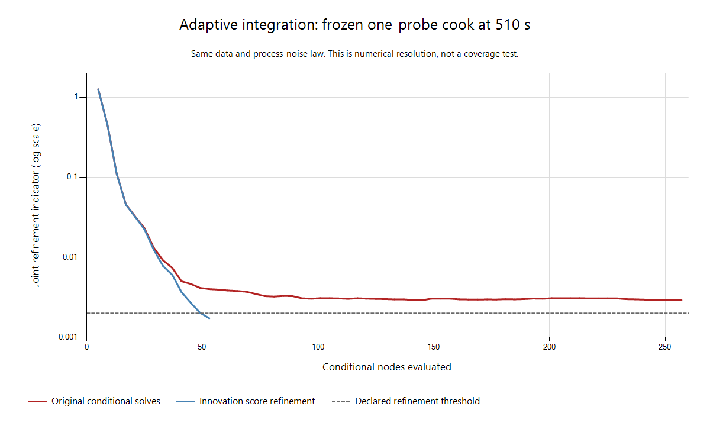

# Adaptive deterministic integration: development record

This work implements adaptive continuous integration over selected non-Gaussian
coordinates and improves the conditional mode solve. It is **not a consistency
qualification or a deployment**. The live defaults, calibration export, priors,
process-noise anchors and measurement likelihoods are unchanged. No Monte Carlo
is used by the new inference path.

The target snapshots are the four previously exposed failures from the
[curvature audit](../2026-09-28-curvature/README.md), with backend `d31877a10f94`
and physics `c2c7bbf8c0ec`. The 21001–21064 reserved seeds remain untouched.
Simulation truth is not passed into node placement, optimization or axis selection.

## What changed

`estimator/src/adaptive_density.jl` is an experimental standalone module. Each
cell interpolates the marginal **log density**, conditional means, and Cholesky
geometry. Exponentiation and log Cholesky diagonals keep the density and its
conditional covariance positive. Positive Gauss–Legendre quadrature normalizes
the resulting continuous density; quadrature nodes are not posterior atoms.

Each leaf is compared with a split in every integration direction. The comparison
includes marginal mass and the full conditional Gaussian KL, including small
contrasts and correlations. The largest contribution selects the next local
refinement. Two integration orders check numerical integration separately from
interpolation. Oracle results are cached. A node budget failure remains unresolved.
The indicator compares approximations; it is not a rigorous error bound against
the target. All representations have a finite declared box, and report that
unseen modes and tails are unvalidated.

A final numerical stress test found two additional hazards. Parent-relative
linear error caching can overflow when a child discovers a much stronger mode;
the final kernel caches and ranks errors in log space. Two quadrature orders can
also agree while missing the same narrow peak. Tensor Bernstein coefficients
bound the interpolated log density between sample points. A cell whose quadrature
does not approach that bound is charged its entire mass upper bound until it is
refined or certified negligible. Per-cell integration errors prevent cancellation
and direct refinement to the unresolved cell. This guards peaks in the current
polynomial interpolant; it cannot discover a true-target mode absent from every
oracle sample. The regression integrates a symmetric pair of modes with standard
deviation .001 on [-5,5], recovers both masses, and remains invariant to a -1e6
log-density offset. No sampling or posterior-specific noise adjustment is involved.

`estimator/scripts/adaptive_conditional.jl` connects this rule to the original
factor graph. Every node solves its own conditional problem; no previous
posterior is recycled as data. A correction hook updates the conditional mean,
covariance **and evidence** together. It accepts both an offline graph and a
cloned full-history online arrival. The online candidate helper preserves the
caller's complete graph and factor registries and does not commit a live belief.

The final adapter also carries the curvature solver's dynamics decoder alongside
its innovation mean and covariance. Previously, the corrected innovation law was
decoded with the original ODE tolerances. The physical-state differences were
small (up to about 1.1e-5 in the checked coordinates), but reached .00679 conditional
standard deviations. That mismatch is now removed, and every node must declare
the same numerical decoder. Shape probes and decoded warm starts use that map
too. Process whiteners and their anchors remain fixed.

`estimator/scripts/adaptive_curvature.jl` can evaluate the full observed Hessian,
with two differencing scales and the tighter ODE evaluation established by the
curvature audit. The original process covariance and its anchor are retained.
Unresolved or indefinite curvature is rejected; no eigenvalue clipping is used.

It also finishes conditional modes in innovation coordinates. Direct process
innovations avoid subtracting nearly equal state trajectories. Near the mode,
ODE objective changes were about 1e-10 while numerical objective fluctuations
were about 1e-9. A line search based only on objective differences stalled even
though the score still resolved an improving step. The new finishing solve uses
the squared norm of the exact score as its merit function, with a 1e-5 stopping
criterion. Inverse BFGS accelerates this solve; **its matrix is never used as the
posterior covariance**. The GN or full observed metric is recomputed separately.

The score solve can rescue an unfinished state-coordinate solve only after it
meets its own criterion. Otherwise the node still fails. A small score alone does
not establish a minimum: the observed-Hessian path additionally requires positive
definite full curvature. The GN ablation remains an explicitly weaker approximation.

## Results established so far

The one-probe target is the exposed 22003 cook at 510 seconds; the two-probe
target is 22004 at 630 seconds. Neither is a full-cook coverage experiment.

| Target / method | Integration nodes | Refinement indicator | Wall time | Interpretation |
|---|---:|---:|---:|---|
| One probe, original conditional solves, tolerance .01 | 33 | .00915 | 35.6 s | Resolves the coarse integration check |
| One probe, original conditional solves, tolerance .002 | 257 | unresolved | 191.8 s | Stalls near .003 and exhausts the node budget |
| One probe, innovation score solve, tolerance .002 | 53 | .00172 | 49.0 s | Resolves the tighter check |
| Two probes, innovation score solve, tolerance .002 | 61 | .00184 | 55.9 s | Resolves the tighter check |
| One probe, score solve plus full observed curvature, tolerance .002 | 53 | .00171 | 1,247.4 s | Resolves the tighter check; maximum probed shape defect .01139 |
| One probe, guarded integration before decoder fix | 53 | .00172 | 43.6 s | Resolves; maximum probed shape defect .06387 |
| Two probes, guarded integration before decoder fix | 61 | .00184 | 44.1 s | Resolves; maximum probed shape defect .01934 |
| One probe, final shared-decoder source | 53 | .00172 | 66.7 s | Resolves; maximum probed shape defect .05635 |
| Two probes, final shared-decoder source | 61 | .00184 | 69.5 s | Resolves; maximum probed shape defect .01972 |

Node counts exclude three additional conditional fits for shape probes. Times
include those probes and exclude dependency startup; some include first-use
compilation. They are not controller latency guarantees. The full
observed-Hessian correction is substantially more expensive.

In the final combined run, every checked full Hessian was positive definite,
the largest step-size change was 3.55e-5, and the largest final score in observed
curvature units was 8.8e-6. This improves the local approximation and integration;
it does not certify the entire conditional remainder. A separate Hessian benchmark
compared direct second-order AD with finite differences of the exact AD score:
32.4 versus 12.4 seconds when warm, with operator-norm disagreement 5.33e-6.
Direct AD did not provide a speed improvement in that benchmark.



The original-mode one-probe run with full observed curvature reached .00918 in
33 integration nodes and 481 seconds. Its maximum checked shape defect was .0161,
versus .0647 for the corresponding GN candidate. The estimated joint TV upper
bound **between these two approximations** was .05684. Curvature correction is
therefore material even where the old shape threshold happened to pass.

An online replay from the last accepted one-probe state at 75 seconds to the
510-second arrival matched the offline graph candidate to about 5e-15 in the
comparison calculation. Process whiteners and their anchors matched exactly;
the caller's smoother was unchanged. This validates shared target construction
and candidate ownership, not a live deployment or online consistency.
The final shared-decoder replay, with the .002 integration criterion and polished
GN geometry, agrees with its offline counterpart to 7.2e-15 in the same comparison
(48.4 seconds). The caller and process-noise anchors remain unchanged. A separate
physical-map check gives innovation round-trip error 1.23e-10 in conditional
covariance units and target-value round-trip error 1.60e-14.

Expanding the integration box from ±4 to ±6 after improving the mode solve gave
a joint comparison estimate .001384, with numerical integration change 4.3e-6.
This is evidence of local domain stability for the GN approximation, not proof
that remote modes or all posterior tails have been found.
The wider fit took 66.8 seconds and 57 integration nodes plus three shape fits;
the score solve rescued one unfinished original optimization without loosening
the 1e-5 score criterion. Its longest finishing solve took five BFGS steps.

The rich-suite extension with three automatically selected coordinates exhausted
729 integration nodes: its last complete refinement indicator was .941 and final
quadrature error .0772. The four-coordinate pit/core diagnostic was stopped after
219 completed node fits, before completing its first directional refinement check.
It is recorded as **incomplete**, with no shape or resolution verdict. This shows
the cost of the present tensor-cell representation as dimension grows.

The initial richer-suite extensions failed during conditional mode finishing.
Those superseded failures remain in the logs, along with the original wider-box
failure and the unsuccessful objective-based finishing solve. They are not
converted into accepted beliefs or omitted low-weight nodes.

### Continuation through the development horizon

Both sparse-sensor graphs were extended with every remaining batch to 1,800
seconds. This is the complete planned synthetic development horizon, not a
complete real brisket cook or an independent coverage experiment. Full original
history and the existing process-noise anchoring schedule were retained.

With the guarded kernel before the decoder fix, the one-probe case resolved at .001391 in 61
integration nodes plus three shape fits. Its maximum checked shape defect was
.05525; fitting and shape checks took 75.8 seconds, excluding history construction.
The two-probe case resolved its one-coordinate integral at .001875 in 57 nodes
plus three shape fits (71.5 seconds), but its conditional shape defect was **2.063**
and failed. Numerical integration success therefore did not become belief
acceptance. The largest residual defect selected the second probe-depth coordinate
for a two-coordinate follow-up; neither sensor labels nor truth chose that axis.

The two-coordinate follow-up exhausted its budget after 255 integration nodes
and two of the three required shape fits (398.6 seconds). Its last complete
refinement indicator was .1937 and final quadrature error .01699. The two completed
shape probes had maximum defect .1338, but the shape check was incomplete and
the density unresolved. This is not an accepted two-probe solution.

A full observed-Hessian diagnostic at the worst one-coordinate shape probe took
52.6 seconds. Its Hessian was positive definite, with step-size change .000741
and asymmetry .000116. Replacing GN curvature reduced the radius-one shape defect
only from about 2.06 to **2.00**. The late two-probe failure therefore persists
beyond covariance correction at this checked location: the conditional shape
needs additional representation, whose integration cost remains unresolved.

After the shared-decoder correction, the one-probe 1,800-second repeat still
resolved at .001391 in 61 integration nodes plus three shape fits, with maximum
checked shape defect .06094 (122.1 seconds). This is the final-source result;
the preceding timings and diagnostics are retained to show the ablations.
The final-source two-probe repeat resolved at .001876 in 57 integration nodes
plus three shape fits (88.9 seconds), and again failed shape at **2.06259**.
The decoder correction did not hide or remove that structural failure.

## Reproduction and interpretation

The reusable driver checks the frozen backend and physics fingerprints, records
the snapshot/source hashes, and writes strict JSON, including failures:

```powershell
julia --startup-file=no --compiled-modules=existing --threads=4 --project=estimator estimator/scripts/validate_adaptive.jl scratchpad/curvature_audit/core.jls core_adaptive.json polished_gn 4 .002
julia --startup-file=no --compiled-modules=existing --threads=4 --project=estimator estimator/scripts/validate_adaptive.jl scratchpad/curvature_audit/core.jls core_observed.json observed 4 .002
```

For other original graphs, load `BrisketEstimator` as `E`, include
`curvature_audit.jl`, `adaptive_conditional.jl` and `adaptive_curvature.jl`, then
call `adaptive_conditional_fit` with explicit axes and an integration chart.
`adaptive_arrival_candidate` uses the same function for chronological online data
and requires a full-history anchor with fixed calibration. These tools deliberately
remain outside live defaults while the remainder, domain and runtime are unqualified.

The analytic tests include separated modes, a curved distribution with a third
cross moment, changing conditional covariance with unchanged marginal evidence,
correlated Gaussian contrasts, box-overlap comparisons, budget exhaustion,
failure propagation, evidence/covariance correction, and rejection of a saddle.
The finishing-solve regression starts with a deliberately unfinished optimizer
and checks recovery of a known analytic posterior, including its mean.

The final source passed 102 distinct assertions: 46 density checks, 20 graph-adapter
checks, 15 curvature/mode checks, 10 online replay/ownership checks, four strict
JSON checks, two checks rejecting already marginalized history, and five checks
of the shared physical decoder. The history checks
prevent merely increasing `lag` from pretending that discarded nonlinear history
has been recovered. The full repository suite was not rerun: production source
and defaults did not change in this stage.

Provenance: `run-source-manifest.json` records the sources used for the initial
ablation, rich-suite and unguarded continuation runs. The earlier integration
kernel is preserved in `sources/adaptive_density-before-log-errors.jl`.
`guarded-run-source-manifest.json` records the next revision, which adds log-space
errors and the Bernstein guard. Its adapter and curvature callback are preserved
in `sources/*-before-decoder.jl`. Results named `guarded` use this revision.
`source-manifest.json` records the final source, which also shares the corrected
decoder. Results named `decoder` use that source. Earlier results are retained
as development evidence, not relabeled as final-source results.
Serialized candidates remain local and are listed by hash in
`candidate-manifest.json`; JSON reports and the drivers are archived here.
Archived job drivers retain their original `scratchpad/adaptive_work` relative
paths and module-loading dependencies; replay them from that location in order.
The standalone `validate_adaptive.jl` command above is the reusable entry point
for an individual frozen failure snapshot.

Still required: consistent resolution of the rich and pit/core targets, full
conditional/tail reference checks, continuation through complete cooks, held-out
coverage under sensor dropout and suite changes, real-cook model discrepancy,
nonlinear predictive decision integration, and an acceptable online resource
budget. Resolution and finite shape checks do not replace those requirements.
The immediate representation problem is the coupled depth uncertainty: adding
another coordinate improves the checked remainder but makes the present tensor
integration too expensive. The next method comparison should address that cost
with adaptive sparse interpolation or a nonlinear coordinate map, retaining the
same target, explicit unresolved outcomes and independent tail checks. Increasing
the case budgets alone would not qualify an online estimator.

## Research basis

Posterior-focused adaptive interpolation is supported by
[Farcas et al., adaptive sparse Leja approximations](https://arxiv.org/abs/1904.12204).
Their implementation and convergence claims are not attributed to this cell-based
prototype. [Chen, Villa and Ghattas](https://arxiv.org/abs/1706.06692) motivate
posterior-aware quadrature coordinates, with assumptions that do not establish
accuracy for these non-Gaussian cooks. Scaled nonlinear residual stopping and
globalized root solving are standard techniques documented by
[SUNDIALS KINSOL](https://sundials.readthedocs.io/en/latest/kinsol/Usage/index.html).
The score solve here is a small implementation for this experiment, not a KINSOL binding.
