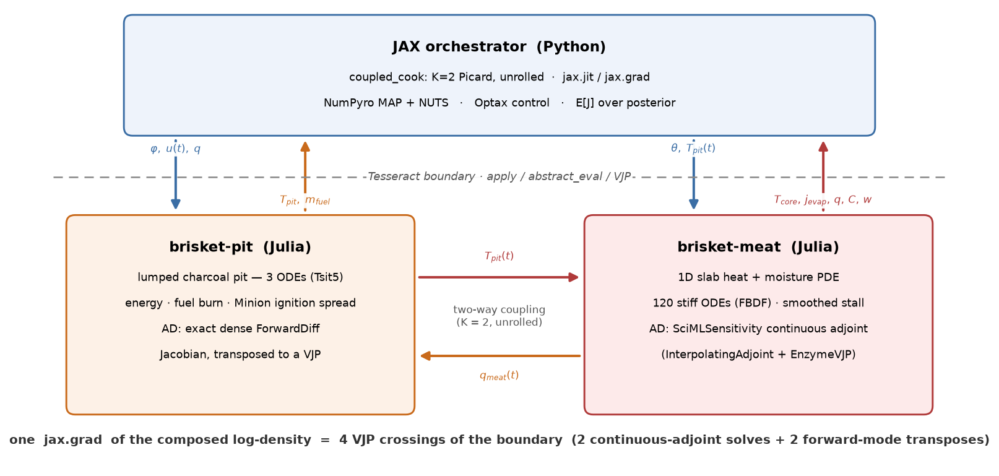

# Differentiable BBQ: Bayesian Calibration and Optimal Control of a Coupled Smoker–Brisket System

**Track 04 — Differentiable inference & UQ** (cross-track: 02 — Multi-physics & coupled systems)
**Repo:** https://github.com/JRock95/BrisketDynamics · Apache 2.0 · all code authored Aug 3–31, 2026

Real barbecue is a coupled multi-physics control problem. A charcoal pit with
its own thermal dynamics drives heat into a brisket whose internal physics —
heat conduction and moisture transport with surface evaporation — produce the
famous **stall**: a multi-hour plateau in internal temperature caused by
evaporative cooling. We built the physics in Julia, wrapped the whole coupled
system as one Tesseract with forward-mode derivative endpoints, and used the
derivatives from JAX for: Gauss–Newton and NUTS Bayesian calibration on a real
19-hour cook log, a duration × wrap × pull × chimney × spritz × damper-schedule plan scored at
serve, robust control in expectation over the posterior, and receding-horizon
MPC that re-times the wrap, the pull, the chimney and the spritz policy.
This document follows the six judging criteria in order.

## 1. Composition across a real boundary

**Where the boundary is.** `brisket-monolith` is one Tesseract around the whole
physics: the lumped charcoal pit (energy balance, fuel burn with a smooth
burnout taper, Minion-method ignition spread), the 1D slab heat–moisture PDE of
the brisket (denaturation-driven water expulsion, fat rendering, collagen
kinetics, a two-sided surface flux — evaporation and condensation — against
the pit's vapor pressure, draft-scaled convection, Maillard and
smoke-deposition bark states, a smoke-ring front), and the quasi-steady pit
humidity balance, integrated together as a 166-ODE stiff system (method of
lines, FBDF). Its inputs are the meat and pit parameters, the damper schedule,
the wrap, pull and fuel-addition times, the spritz policy, the number of
briskets, initial conditions (including the full meat field
for state handoff) and the rest-environment constants; its outputs are the
trajectories and the terminal quality vector.

**How it differentiates.** Forward mode through the solve (ForwardDiff): the
parameter count is small (15 physics latents, ~27 control knots) and the
forward solve is ~0.05 s, so
- `jacobian_vector_product` is one Dual solve,
- `vector_jacobian_product` and `jacobian` are one chunked pass over the
  requested inputs (a 230 × 15 residual Jacobian in 2.5 s; a 27-column
  control Jacobian in ~2 s at an 8 h horizon).

tesseract-jax consumes all three, so JAX has reverse *and* forward mode
through the same interface: `jax.grad` for Optax and NUTS, the full Jacobian
for Gauss–Newton and the Fisher information.

**Cost, on the real-cook grid (19 h, 115 points):** forward solve 0.045 s,
the 230 × 15 calibration Jacobian 2.5 s, the duration × wrap × pull scan of
13 cook lengths 95 min, the four-cook MPC demo 68 min.

The exchange-grid composition of the two component solvers is kept in Julia
(`picard_cook`) as the oracle for the monolith's coupling: it converges to the
monolith as the pass count grows (K = 8 within 0.04 K). The stall mechanism —
and the place where differentiability was deliberately engineered — is the
meat's surface boundary condition: mass-transfer-limited evaporation driven
by the sorption isotherm — the surface's own vapor pressure against the
pit's — two-sided and smooth in every input,

$$
j_{evap} \;=\; k_m \,\frac{a_w(W_s)\,p_{sat}(T_s) - p_{pit}}{R_v\, T_s},
\qquad
k\,\partial_x T\big|_{s} \;=\; h_c\,(T_{pit}-T_s) + \varepsilon\sigma_{SB}\,(T_{pit}^4-T_s^4) - \lambda_{vap}\, j_{evap},
$$

so the plateau emerges and breaks smoothly, and the pit's own vapor pressure
(combustion water, the meat's evaporation, dilution by the draft) feeds back
into it. The complete equation set is in `docs/model.md`. Real-cook
calibration is a masked AR(1) Gaussian: lid events break the chain,
$\sigma_0 = 1.2$ K is the digitization floor on the marginal residual scale,
and a $\rho \in (0, 0.95)$ per probe absorbs the smooth discrepancy the iid
model would count as independent observations.

**Verification.** Three levels, all against central finite differences
(`docs/verification.md`): the Julia Jacobian and JVP (residual columns to
~1e-4 relative; the pull column of the stacked outputs to 2e-2 across the
300 s pull blend; JVP vs Jacobian·tangent to 5e-3); the endpoints against
each other (`jvp = J·v`, `vjp = Jᵀ·w`); and `jax.grad` through `coupled_cook`
on a scalar loss over all 7 pit parameters, the meat transport latents, damper
directions, wrap and pull times and the damper→burn-rate→smoke→bark-color
chain. One measured fact worth knowing: the Jacobian of an adaptive stiff solve
moves ~4e-5 relative under a last-bit change of an input at solver tolerance
1e-6 (5e-7 at 1e-8, 3.7× the cost), and near an optimum the gradient of the log
density cancels O(1e3) terms, so two exact gradient paths differ by ~0.5 %
there. The tests are written to know that.

## 2. Derivatives doing real work

**Calibration on a real cook** (`figures/cooklog_fit_map.png`): a 19-hour
brisket cook digitized from a 2013 Virtual Weber Bulletin Board post (18.5″
WSM, HeaterMeter controller; provenance and uncertainty budget in
`data/cook_log/PROVENANCE.md`). The measured blower duty replays as the
control input; lid events are masked. The fit tracks the pit hold within
~1.3 K rms and the core's full arc — rise, multi-hour plateau near 70 °C, the
stall break, the climb to 90 °C (core rms 3.0 K).

- **Gauss–Newton MAP** (`scripts/run_gn_map.py`): Levenberg–Marquardt over
  the 15 physics latents in numpyro's unconstrained space on the whitened
  AR(1) residuals, from a cold start at the prior medians: F = 5317 → 133.2
  in 14 iterations, **103 s**.
- **Curvature.** The Fisher information (Jᵀ Σ⁻¹ J + prior) from the same
  Jacobian is the posterior curvature used everywhere — the Laplace draws
  (Gauss–Newton in the physics block; the noise and cross blocks exact by
  `jax.hessian` of the model with the solve replaced by its tangent model),
  the NUTS metric, the robust-control draws. A finite-difference Hessian of
  the potential at the same point is indefinite (min eigenvalue −20 against
  a max of 1.7·10⁵; 8 of 18 directions below a 10⁻⁴ floor): second
  differences of an adaptive solve are noise along the ridges, which is the
  quiet argument for exact derivatives. The Fisher says what the corners
  show: the meat side is pinned (L, k_m, h_c to a
  few percent), the pit side only along ridges — UA ∝ ΔH_eff (loss vs heat
  release) and r_max vs u_leak (burn rate vs leak dilution), the fingerprint
  of closed-loop data.
- **The doneness scale, anchored.** Collagen conversion at the center is the
  tenderness proxy, with a two-sided band (target 0.90, overdone above 0.95).
  At the calibrated parameters the pitmaster's pull (19.0 h, 89.5 °C core)
  sits at C = 0.874: the one real "done" judgment we have lands just under the
  target, and the rest carries it into the band.
- **NUTS on the monolith** (`scripts/run_nuts_mono.py`): `model_real` on the
  Tesseract, initialized at the LM MAP with a dense mass matrix seeded from
  the Gauss–Newton Fisher covariance (ridge widths included; a metric from a
  floored finite-difference Hessian understated them 3–6× and every
  trajectory hit the tree-depth cap), one chain per process. Two chains of
  300 warmup + 600 draws, 21.6 h each on a laptop (31-step trajectories,
  step sizes 0.139 and 0.124, mean acceptance 0.93 / 0.91): **0 divergences
  in 1200 draws**, split-r̂ ≤ 1.010 on all 19 sites, ESS 169–900 with a
  median near 450 — the pit ridge, which an earlier 300-draw run left at
  ESS ≈ 20, comes in at 436 (ΔH_eff) and 467 (UA). The least-identified
  quantities are the burn-rate/leak ridge (r_max 172, u_leak 177) and the
  pit noise scale (σ_pit 169), which is the identifiability claim in
  reverse: the meat side is pinned, the pit only along its ridges.
  Posterior widths sit on the Gauss–Newton Fisher and the Laplace within
  ~10–20 % on 13 of 15 physics sites — the curvature statement holds — with
  the heavy-tailed exceptions the quadratic approximations cannot carry
  (k_spread 1.14 in z against ~0.6, a0 0.74 against the Laplace's 0.47).
  The corner (`figures/corner_nuts_real.png`) shows both pit ridges
  directly, and the predictive band
  (`figures/posterior_predictive_nuts_real.png`) brackets the pit trace and
  the core arc with the same early-core bias the MAP fit has.
- **The cheap posterior, chosen by measurement.** Eighteen approximation
  variants (Laplace, profile and TMB/INLA nested-Laplace grids, structured
  Student-t/mixture families, surrogate-transition samplers, ADVI/IWAE)
  were scored against the NUTS reference by per-site 1-Wasserstein
  distance in unconstrained coordinates
  (`scripts/compare_approx.py` → `data/calibration/approx_summary.md`,
  `figures/posterior_widths.png`). The winner, and the supported chain, is
  Gauss–Newton Laplace plus a TMB/INLA nested-Laplace marginal on the two
  heavy-tailed ignition coordinates — an 11×11 grid with a converged inner
  Newton and the ½ log det correction, ~51 min — which matches NUTS to
  W1 0.095 (tied with an oracle fit to the NUTS draws themselves), against
  0.148 for the Laplace alone. A PSIS check against the true ODE guards
  the family: with the Zhang–Stephens Pareto-k̂ (a moment-fit k̂ had
  under-read 0.76 as 0.30) the proposal reads k̂ = 0.76, and
  importance-weighted moment matching (Paananen et al. 2021) repairs it to
  k̂ = 0.47 in three accepted transforms. Retired by the same scoreboard:
  surrogate-transition refinements (4+ h for no W1 gain over the grid) and
  ADVI/IWAE (5–10× too narrow, or divergent, in every configuration —
  along the way a `TransformedDistribution` support bug that let the guide
  draw ρ > 0.95 into an undefined log-prob was found and fixed with
  `domain=`).

**The plan** (`figures/fullplan.png`): the perfect brisket picks its own
length. An outer scan over cook lengths (start to serve, 8–20 h), and inside
each the damper schedule, the Texas-crutch wrap time and the pull time are
optimized jointly against a KCBS-weighted quality objective — appearance 0.14
(a two-sided mahogany L* band), taste 0.57 (smoke-deposition band + perceptual
juiciness), tenderness 0.29 (the collagen band, undershoot and overshoot
weighted equally) — plus the bark-burn surface cap, fuel priced at the pull,
and food-safety soft penalties. Quality is scored at serve: the rest is part of
the cook, the pull is a decision, and the rest is what follows it. On the
calibrated smoker the objective has an interior optimum: J falls from 1.35
at 8 h to 1.07 at 11–12 h and climbs back to 1.23 at 20 h. The 11 h cook
wraps at 7.1 h, pulls at 8.4 h, rests 2.6 h, and serves at doneness 0.946
with 39 % perceptual juiciness. It adds no fuel and does not spritz: a
spritz is mostly evaporative cooling (a fifth of it soaks in), and the
longer stall costs more than the water is worth. The short cook is a hot
one — the schedule takes the pit to 165 °C around 6 h, the core clears its
69 °C stall by 4 h and reaches 93 °C by 6.5 h, and the late wrap holds it
there to the pull. Longer cooks lose the trade on juiciness: with the
isotherm-driven surface the meat keeps evaporating for as long as it is
unwrapped (retained water 0.32 at 12 h, 0.27 at 18 h), which is the
water-budget residue in the roadmap. The scan converges to the 1e-3 level
(the 12 h optimum at a 600-iteration cap is J 1.065 against the scan's
1.066) and its warm start from one length to the next is what finds the
good basin — started cold, the 11 h cook stops in a poorer one at J 1.46.

**Receding-horizon MPC** (`figures/mpc_demo.png`): the calibrated smoker
as plant, the 11 h plan under defense, hourly replans from the measured state
(full T/W/C/F/B/S-field handoff through the Tesseract), replanning the
schedule, the wrap, the pull, the chimney and the spritz policy; the
irreversible events execute like the real thing —
candidate, commit gate, irreversible — and the plant rests to serve. At
t = 2 h a cold front drops ambient by 15 K that the controller's model does
not know. Executed blindly, the plan finishes at doneness 0.57 (J = 14.1);
MPC re-times the crutch 7.06 → 6.84 h and the pull 8.39 → 9.38 h and lands at
doneness 0.945, J = 1.067. Without the front MPC lands at J = 1.070 against
the plan's own 1.093 — the hourly replans refine a plan its optimizer left
a few thousandths short — the principle-of-optimality check.

**Control under calibrated uncertainty** (`figures/control_robust.png`):
re-optimizing the expected plan objective over 8 posterior draws (25 min on
the monolith), evaluated on 30 held-out draws against the plan-optimal
schedule. The fast plan is knife-edged under parameter uncertainty: on the
held-out draws it scores J 5.3 ± 9.6 (worst 54) with doneness 0.91 ± 0.11
(minimum 0.59). The hedge moves the wrap earlier (7.06 → 6.66 h), the pull
1.8 h later (8.39 → 10.20 h) and reopens the vents after 9 h, for
J 1.81 ± 0.60 (worst 4.1) and doneness 0.975 ± 0.031 (minimum 0.86) —
the robust cook gives up a little nominal quality to never serve a tough
brisket.

**The bark model** (`figures/bark_model.png`): Maillard browning (first-order
in lightness, Arrhenius × a water-activity bell via a smooth sorption isotherm)
and smoke-phenolic deposition (requires a moist surface and smoke flux) as
surface states; the smoke flux is the pit's exact burn rate, so bark color is
a genuinely coupled observable and `d(color)/d(damper)` is one of the
verified gradient paths. Constants are literature-anchored and explicitly
uncalibrated (the photo experiment is roadmap item 8). Forward
validation reproduces pitmaster lore: hot-and-fast Maillard-saturates,
low-and-slow is smoke-dominated, wrapping freezes bark.

## 3. Why Tesseract is load-bearing

The outer loops — NumPyro, Optax, the MPC state machine — live in JAX; the
physics lives in Julia. The only derivative path between them is the Tesseract
endpoint interface, consumed by tesseract-jax as a JAX primitive. With forward
mode inside, that interface is not a limitation: `jvp`, `vjp` and `jacobian`
are each one Julia call, so the "every derivative must be an endpoint"
discipline costs nothing, and the same client serves calibration, planning,
MPC and robust control through one `coupled_cook`. The Tesseract around the
whole model is the deployable twin the roadmap wanted — a versioned,
schema-validated service any consumer can differentiate through without
linking Julia.

## 4. A real application

Food engineering / culinary physics — a domain without an existing Tesseract
demo, with real data, a beloved phenomenon (the stall) whose mechanism is
still argued about on forums, and a useful artifact: a calibrated digital twin
of a specific smoker that turns "when do I wrap, when do I pull, when do I open
the vents?" into a posterior-aware optimization scored at serve. The physics
is honest (Choi–Okos properties of each node's composition and temperature;
an isotherm-driven evaporative surface flux, wet-bulb-limited while the
surface is wet;
a shrinking Lagrangian slab, pit humidity feedback, collagen kinetics as the
doneness proxy), and the smoothing that keeps the stall differentiable is what
makes the likelihood tractable.

## 5. Execution & technical depth

- **Two juliacall deadlocks, both timing-dependent.** A zero-copy numpy view
  of Julia memory released from an XLA thread makes Julia's GC wait forever on
  the parked Julia thread; a second executor thread driving one Julia runtime
  deadlocks the moment both are loaded. Both surfaced as hour-long runs going
  quiet at 0 % CPU; both are documented and now structurally impossible (one
  executor per process, copies on the Julia thread).
- **The ρ support bug.** A prior that looked right, sampled wrong; found by
  scoring guide draws one site at a time.
- **Solver jitter under cancellation.** Two exact gradient paths disagreeing
  by 0.5 % near the optimum, traced to a last-bit input change re-routing
  the adaptive stepper — quantified rather than papered over.

## Limitations & where this goes

The wrap and rest constants are literature-fixed pending a wrapped-cook log
(the wrap moment in such logs is a known-input step response). The doneness
band is anchored to one real pull, not to texture data. Juiciness is
mechanistic on both channels but its fat/water sensory weight is a
placeholder; bark and smoke ring are not inside the doneness scalar. The pit's
fast (sub-hour) dynamics are a known deficiency that closed-loop cook logs
cannot repair — the fix is a two-hour open-loop characterization burn, not a
bigger model. Smoke is heat, not a fluid.

What forward mode makes possible next, in order: NUTS as the routine
posterior (hours, not days); control Jacobians for a Newton/SQP controller
with replans in seconds; the online estimator during a cook (the ambient
Kalman filter today; a reactive factor-graph estimator over pit state and
brisket parameters when the model is pure Julia); hierarchical pooling across
a user's cooks (pit parameters are properties of the smoker, meat parameters
per brisket); the acausal component version of the monolith (pit, fuel bed,
wrap, rest, ambient as ports; the slab as a generated component) with the
hand-written monolith as its oracle; and closing the loop on a physical
smoker through HeaterMeter.

## 6. Reproducibility & communication

Everything is pinned (`Manifest.toml`, `uv.lock`) and layered so each claim is
one command (`README.md`): the Julia physics and derivative tests, the endpoint
tests, the composed FD gate, each figure's generating script. The native
no-Docker dev loop (`Tesseract.from_tesseract_api`) runs the full pipeline on
Windows; the container build (`scripts/build_containers.sh`) bakes the Julia
toolchain and precompiled package via `package_data`. Figures: the calibrated
cook fit, corners and posterior-predictive bands (Laplace, VI, NUTS), the plan,
the MPC demo, the robust-control comparison, the bark model.

---

*Data attribution: cook log digitized from a public post by user "Mache" on
The Virtual Weber Bulletin Board (2013), used as a small factual data
extraction with attribution; provenance, method, and uncertainty budget in
`data/cook_log/PROVENANCE.md`.*
